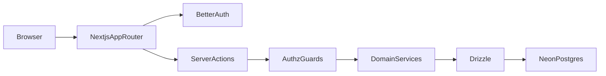

# Architecture — Doxcta Procure (Phase 1–4)

## Overview

Next.js 15 App Router application with:

- **Marketing/auth surfaces** under `(marketing)` + invite routes
- **Company workspace** under `(app)` with Doxcta-styled shell
- **Super Admin** under `(super-admin)/super-admin`
- **Better Auth** for credentials/sessions
- **Drizzle ORM** + **Neon PostgreSQL** for persistence
- Tenant access via `company_memberships` + permission keys

## Key paths

| Path | Role |
|---|---|
| `src/server/auth.ts` | Better Auth factory |
| `src/server/authz.ts` | Session + membership + permission guards |
| `src/server/company-provision.ts` | Shared company bootstrap |
| `src/server/actions/*` | Mutations |
| `src/server/db/schema.ts` | Drizzle schema |
| `src/app/api/auth/[...all]` | Auth HTTP handlers |

## Authorization rules

1. Never trust client-supplied `companyId` alone.
2. Resolve membership for the authenticated user.
3. Reject `suspended` companies on membership-gated routes.
4. Enforce permission keys server-side (`employees.manage`, etc.).
5. Super Admin is `users.is_super_admin`, not a company role.

## Deferred modules

Expense/procurement/budget engines and full marketing site remain Phase 5–12. Nav items are labeled “soon” where unfinished.
