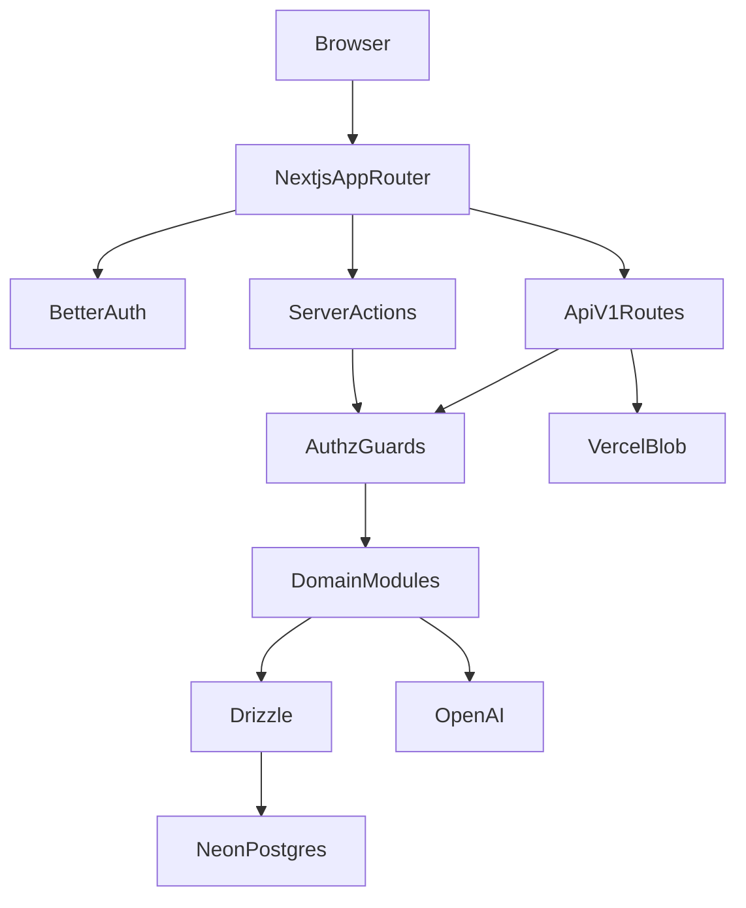

# Architecture — Doxcta AI MVP

## Overview

Next.js 15 App Router modular monolith:

- **Marketing/auth** under `(marketing)` + invite routes
- **Organization workspace** under `(app)` (expenses, invoices, vendors, approvals, payments, budgets, reports, AI assistant)
- **Super Admin** under `(super-admin)`
- **Better Auth** sessions; **Drizzle** + **Neon Postgres**
- Tenant access via `company_memberships` + permission keys (UI says “organization”)

## Domain modules

| Path | Role |
|---|---|
| `src/server/expenses/` | Expense CRUD, export, submit |
| `src/server/invoices/` | Invoice records |
| `src/server/vendors/` | Vendor management |
| `src/server/payments/` | Payment recording + outstanding balance |
| `src/server/approvals/` | Configurable approval chains |
| `src/server/budgets/` | Budgets + utilization |
| `src/server/ai/` | Extraction, processing jobs, assistant |
| `src/server/reports/` | Dashboard/report metrics |
| `src/server/billing/` | Stripe checkout + plan limits |
| `src/app/api/v1/` | Upload, export, PDF summary |

## AI invoice pipeline

1. `POST /api/v1/invoices/upload` validates file, stores blob, creates invoice + job
2. `after()` runs `processInvoiceJob` (OpenAI structured extract; mock if no API key)
3. Validation + duplicate detection
4. Human review at `/invoices/:id/review`
5. Only approved/saved fields become finalized financial amounts

## Authorization rules

1. Never trust client-supplied `companyId` alone.
2. Resolve membership for the authenticated user.
3. Reject suspended companies.
4. Enforce permission keys server-side.
5. AI assistant uses predefined report tools only — no arbitrary SQL, no writes.
6. Super Admin is `users.is_super_admin`, not a company role.

## Out of MVP

Accounting integrations, bank transfers, Arabic/RTL, mobile apps, full PDF generation library, MFA enforcement.
